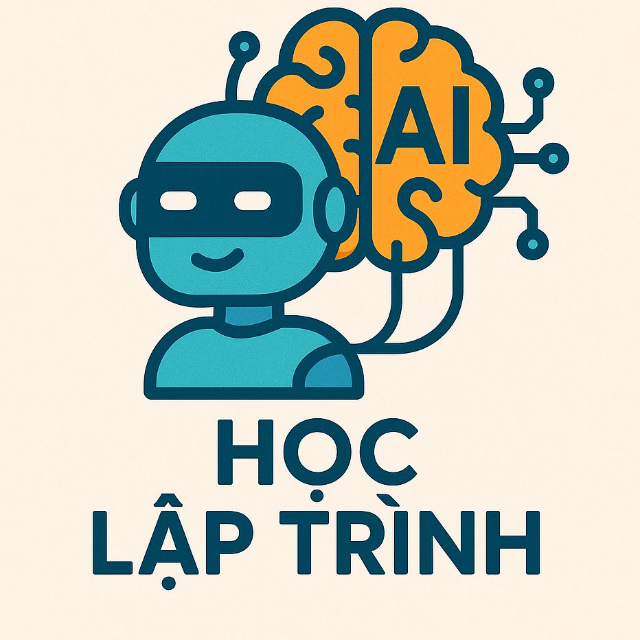
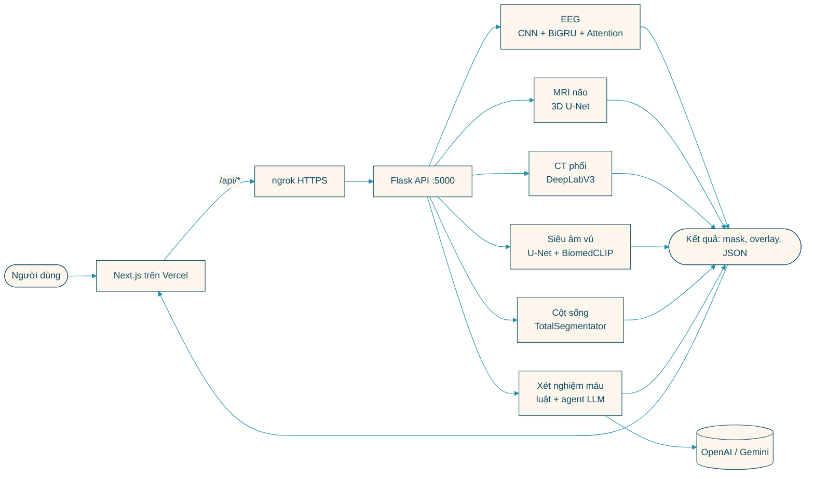
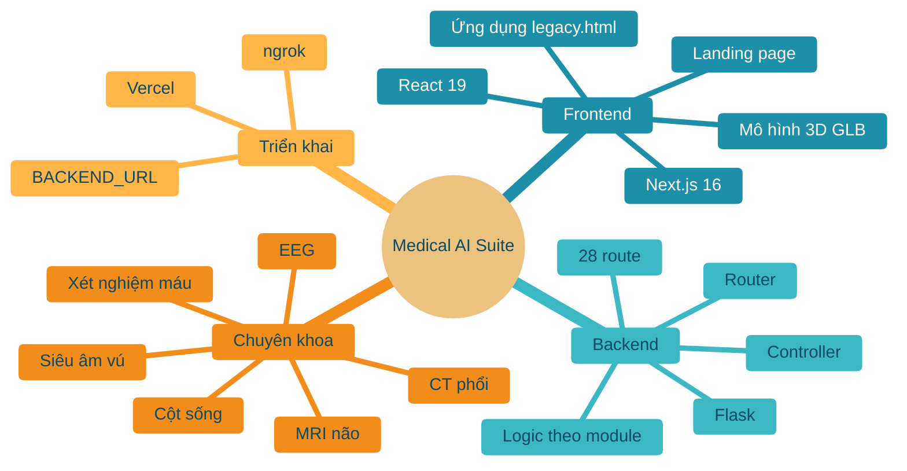
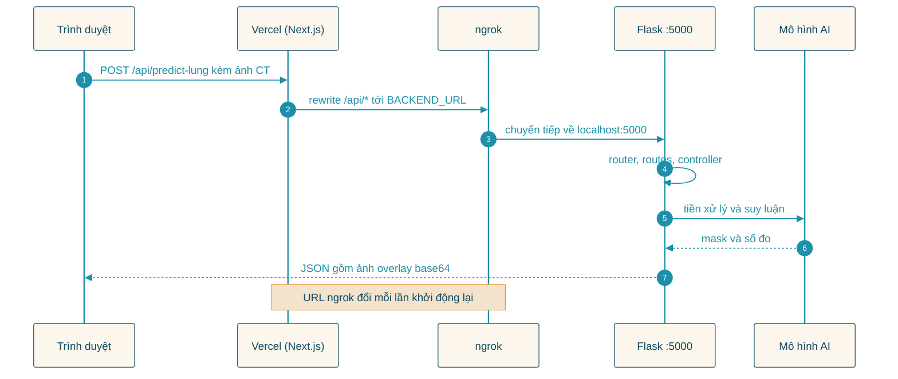
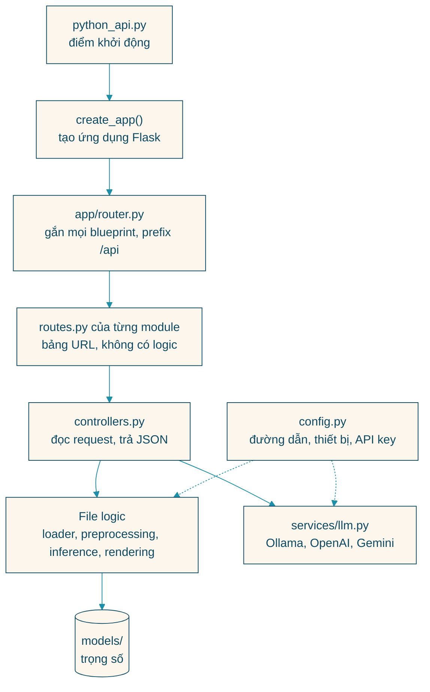
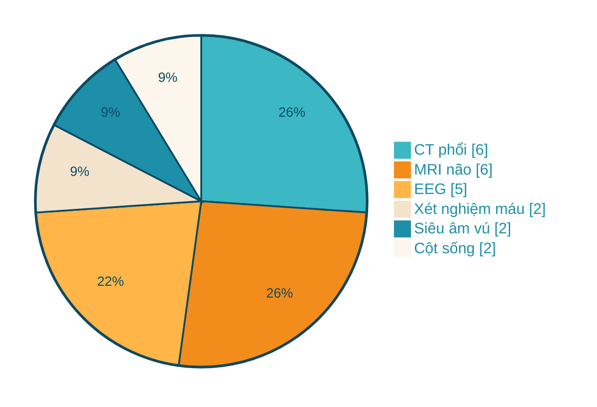
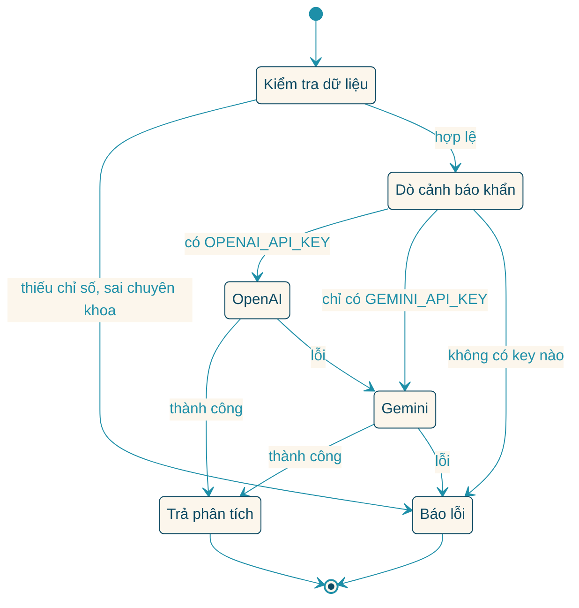
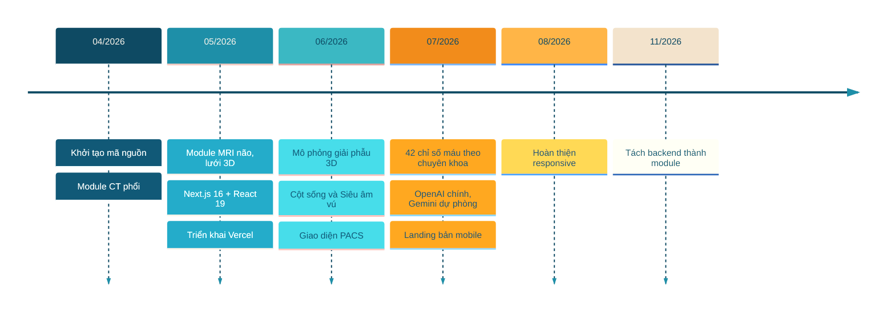

<p align="center">
  
</p>

<p align="center">
  
</p>

<h1 align="center">Medical AI Suite</h1>

<p align="center">
  <strong>Bộ ứng dụng AI y khoa của ADA Group: sáu chuyên khoa (điện não, MRI não, CT phổi, xét nghiệm máu, siêu âm vú, cột sống) chạy trên cùng một giao diện đọc kết quả.</strong><br>
  <strong>Giao diện Next.js đặt trên Vercel, mô hình PyTorch và Keras chạy sau một API Flask.</strong>
</p>

<p align="center">
  <a href="https://tan-nghia-medical-ai.vercel.app"></a>
  
</p>

<p align="center">
  
  
  
  
  
</p>

<p align="center">
  
  
  
  
  
  
  
</p>

> [!IMPORTANT]
> **Bản quyền thuộc về Trương Tấn Nghĩa (AI Học Lập Trình). All Rights Reserved.**
> Mã nguồn được công khai để tham khảo. Xem được repository không có nghĩa là được cấp phép sao chép, phân phối hay dùng lại. Chi tiết trong [LICENSE](LICENSE).
>
> Dự án phục vụ **nghiên cứu và học tập**. Kết quả của mô hình **không dùng để chẩn đoán lâm sàng**.

---

## 📑 Mục lục

- [✨ Điểm nổi bật](#diem-noi-bat)
- [🔄 Luồng xử lý](#luong-xu-ly)
- [🗺️ Kiến trúc qua sơ đồ](#kien-truc)
- [📋 Bảng chi tiết](#bang-chi-tiet)
- [🚀 Cài đặt và sử dụng](#cai-dat)
- [🗂️ Cấu trúc thư mục](#cau-truc)
- [📊 Trạng thái từng thành phần](#trang-thai)
- [✍️ Tác giả](#tac-gia)

---

<a id="diem-noi-bat"></a>

## ✨ Điểm nổi bật

<table>
<tr>
<td width="33%" valign="top">

### 🧠 Điện não (EEG)

Đọc file `.edf`, chia cửa sổ 4 giây và chấm xác suất động kinh bằng mô hình 1D-CNN + BiGRU + Temporal Attention. Mỗi cửa sổ được xếp vào một trong 4 mức cảnh báo.

</td>
<td width="33%" valign="top">

### 🧬 MRI não

Phân đoạn khối u bằng 3D U-Net từ 4 chuỗi NIfTI, có TTA và suy luận cửa sổ trượt. Kết quả gồm ảnh đa mặt cắt và lưới 3D của khối u.

</td>
<td width="33%" valign="top">

### 🫁 CT phổi

DeepLabV3-ResNet50 khoanh nốt phổi trên lát cắt CT, đo đường kính theo mm và dựng thêm mặt cắt coronal, sagittal từ bộ lát cắt LIDC.

</td>
</tr>
<tr>
<td width="33%" valign="top">

### 🩸 Xét nghiệm máu

Nhập tối đa 42 chỉ số, chọn 1 trong 8 chuyên khoa. 22 luật cảnh báo khẩn chạy trước, sau đó agent LLM (OpenAI, dự phòng Gemini) viết phần phân tích.

</td>
<td width="33%" valign="top">

### 🎗️ Siêu âm vú

U-Net phân đoạn tổn thương trên ảnh siêu âm, BiomedCLIP phân loại lành hay ác, kết quả quy về thang BI-RADS trong giao diện kiểu PACS.

</td>
<td width="33%" valign="top">

### 🦴 Cột sống

Giao diện và mô hình 3D đã có. Phần suy luận dùng TotalSegmentator khi được cài, hiện trả dữ liệu mô phỏng. **Đang phát triển.**

</td>
</tr>
</table>

---

<a id="luong-xu-ly"></a>

## 🔄 Luồng xử lý

<p align="center">
  
</p>

Trình duyệt chỉ nói chuyện với Vercel. Mọi request `/api/*` được Next.js chuyển tiếp tới backend Flask qua đường hầm ngrok, nên frontend không cần biết backend đang chạy ở đâu.



---

<a id="kien-truc"></a>

## 🗺️ Kiến trúc qua sơ đồ

### Toàn cảnh hệ thống



### Vòng đời một request



### Các tầng của backend



<table>
<tr>
<td width="50%" valign="top">

**23 route nghiệp vụ theo chuyên khoa**



Cộng thêm 5 route hệ thống (`/health` và các route tương thích) là đủ 28.

</td>
<td width="50%" valign="top">

**Agent xét nghiệm máu chọn LLM thế nào**



</td>
</tr>
</table>

### Lịch sử phát triển

Các mốc dưới đây lấy từ `git log` của repository.



---

<a id="bang-chi-tiet"></a>

## 📋 Bảng chi tiết

<details>
<summary><strong>🧪 Mô hình theo từng chuyên khoa</strong></summary>

<br>

| Chuyên khoa | Mô hình | Dữ liệu | Đầu vào | Đầu ra chính |
|:---|:---|:---|:---|:---|
| EEG | 1D-CNN + BiGRU + Temporal Attention (PyTorch) | CHB-MIT, chia theo bệnh nhân: 19 train, 5 test | File `.edf`, tối đa 23 kênh, 256 Hz, lọc 0.5 đến 40 Hz | Xác suất động kinh từng cửa sổ 4 giây, 4 mức cảnh báo, công suất 5 dải tần |
| EEG (ảnh) | Mô hình thị giác chạy qua Ollama | Không huấn luyện | Ảnh chụp điện não đồ | Nhận xét dạng JSON |
| MRI não | 3D U-Net (Keras), TTA, cửa sổ trượt | BraTS | 4 chuỗi NIfTI (FLAIR, T1, T1ce, T2), khối 128³ | Mask theo lớp, ảnh đa mặt cắt, lưới 3D bằng marching cubes |
| MRI não (YOLO) | YOLOv8 | Chưa có trọng số riêng | 1 ảnh MRI | Khung phát hiện. **Đang phát triển** |
| CT phổi | DeepLabV3-ResNet50 (PyTorch) | LIDC-IDRI | Ảnh lát cắt CT, đưa về 512 × 512 | Mask nốt, đường kính mm, mức ác tính, ảnh MPR |
| Xét nghiệm máu | 22 luật cảnh báo khẩn + agent LLM (OpenAI, dự phòng Gemini) | Không huấn luyện | 42 chỉ số, 8 chuyên khoa, thông tin bệnh nhân | Phân tích theo chuyên khoa, cảnh báo khẩn, khuyến nghị |
| Siêu âm vú | U-Net (chính), Attention U-Net (dự phòng), BiomedCLIP phân loại | BUSI | Ảnh siêu âm, tuỳ chọn khung chọn vùng | Mask, đường kính, lành hay ác, BI-RADS |
| Cột sống | TotalSegmentator (tuỳ chọn) | Chưa có | Ảnh chụp cột sống | Danh sách đốt sống, góc Cobb. Hiện là dữ liệu mô phỏng |

Chỉ số đo được của mô hình EEG, đọc từ file metadata sinh ra lúc huấn luyện: **ROC-AUC 0.839**, PR-AUC 0.529, ngưỡng quyết định 0.4, 35 epoch.

</details>

<details>
<summary><strong>🔌 28 API route của backend Flask</strong></summary>

<br>

| Chuyên khoa | Phương thức | Đường dẫn | Việc làm |
|:---|:---:|:---|:---|
| EEG | `POST` | `/api/predict-edf` | Phân tích file `.edf` |
| EEG | `GET` | `/api/model-info` | Thông tin mô hình EEG |
| EEG | `GET` | `/api/model-status` | Tên cũ của `/api/model-info` |
| EEG | `POST` | `/api/analyze` | Phân tích ảnh điện não bằng mô hình thị giác |
| EEG | `GET` | `/api/eeg-image-status` | Trạng thái mô hình thị giác |
| CT phổi | `POST` | `/api/predict-lung` | Phân đoạn nốt phổi trên ảnh tải lên |
| CT phổi | `GET` | `/api/lung-model-info` | Thông tin mô hình phổi |
| CT phổi | `GET` | `/api/lung-model-status` | Tên cũ của `/api/lung-model-info` |
| CT phổi | `GET` | `/api/lung-dataset` | Liệt kê bệnh nhân và nốt trong bộ LIDC |
| CT phổi | `POST` | `/api/predict-lung-dataset` | Phân tích một lát cắt trong bộ LIDC |
| CT phổi | `GET` | `/api/lung-dataset-image` | Trả ảnh một lát cắt |
| MRI não | `POST` | `/api/predict-brain` | Phân đoạn khối u 3D |
| MRI não | `POST` | `/api/predict-brain-yolo` | Phát hiện 2D bằng YOLOv8 |
| MRI não | `GET` | `/api/brain-model-info` | Thông tin mô hình não |
| MRI não | `GET` | `/api/brain-model-status` | Tên cũ của `/api/brain-model-info` |
| MRI não | `GET` | `/api/brain-models` | Liệt kê các checkpoint có sẵn |
| MRI não | `POST` | `/api/brain-model-switch` | Đổi checkpoint đang dùng |
| Xét nghiệm máu | `POST` | `/api/analyze-blood-agent` | Phân tích chỉ số theo chuyên khoa |
| Xét nghiệm máu | `GET` | `/api/blood-agent-status` | Trạng thái các LLM |
| Cột sống | `POST` | `/api/predict-spine` | Phân tích ảnh cột sống |
| Cột sống | `GET` | `/api/spine-status` | Trạng thái module |
| Siêu âm vú | `POST` | `/api/predict-breast` | Phân đoạn và phân loại tổn thương |
| Siêu âm vú | `GET` | `/api/breast-status` | Trạng thái các mô hình |
| Hệ thống | `GET` | `/health` | Kiểm tra backend còn sống |
| Hệ thống | `GET` | `/api/mcp/status` | Chưa hỗ trợ, trả trạng thái rỗng |
| Hệ thống | `POST` | `/api/mcp/execute` | Chưa hỗ trợ, trả 503 |
| Hệ thống | `GET` | `/api/history` | Chưa hỗ trợ, trả danh sách rỗng |
| Hệ thống | `POST` | `/api/chat` | Chưa hỗ trợ, trả 501 |

Ngoài ra frontend có route riêng [`/api/debug`](frontend-next/app/api/debug/route.ts) để xem Vercel đã nhận biến `BACKEND_URL` hay chưa.

</details>

<details>
<summary><strong>🧰 Công nghệ sử dụng</strong></summary>

<br>

| Tầng | Công nghệ |
|:---|:---|
| Frontend | Next.js 16 (App Router), React 19, TypeScript |
| Giao diện y tế | HTML, CSS, JavaScript thuần trong [`legacy.html`](frontend-next/public/legacy.html) |
| Hiển thị 3D | three.js, GLTFLoader, OrbitControls, mô hình GLB não, phổi, cột sống |
| Backend | Python, Flask, flask-cors |
| Học sâu | PyTorch, torchvision, TensorFlow / Keras, Ultralytics YOLOv8 |
| Xử lý tín hiệu và ảnh | SciPy, pyedflib, OpenCV, Pillow, nibabel, scikit-image |
| LLM | OpenAI, Google Gemini, Ollama |
| Triển khai | Vercel cho frontend, ngrok cho backend chạy máy cá nhân |

</details>

---

<a id="cai-dat"></a>

## 🚀 Cài đặt và sử dụng

> [!WARNING]
> Repository này chỉ chứa **frontend**. Backend Flask, trọng số mô hình và dataset được giữ trên máy tác giả, không đẩy lên GitHub. Khi tự chạy, bạn xem được landing page và toàn bộ giao diện, còn các nút phân tích sẽ báo không kết nối được backend.

### Cách 1: Chạy giao diện

Cần Node.js 20 trở lên.

**Windows (PowerShell)**

```powershell
git clone https://github.com/TruongTanNghia/Project_Em_Dat.git
cd Project_Em_Dat\frontend-next
npm install
Copy-Item .env.local.example .env.local
npm run dev
```

**macOS / Linux (bash)**

```bash
git clone https://github.com/TruongTanNghia/Project_Em_Dat.git
cd Project_Em_Dat/frontend-next
npm install
cp .env.local.example .env.local
npm run dev
```

1. Mở `http://localhost:3000` để xem landing page.
2. Bấm vào một chuyên khoa để vào ứng dụng tại `/legacy.html`.
3. Biến `BACKEND_URL` trong [`.env.local`](frontend-next/.env.local.example) mặc định trỏ về `http://localhost:5000`.

### Cách 2: Chạy đầy đủ với backend

Dành cho máy đã có thư mục `backend/` và `models/`.

**Windows (PowerShell), mở 3 cửa sổ**

```powershell
# Cửa sổ 1: backend Flask, cổng 5000
cd backend
pip install -r requirements.txt
python python_api.py
```

```powershell
# Cửa sổ 2: frontend, cổng 3000
cd frontend-next
npm run dev
```

```powershell
# Cửa sổ 3: chỉ cần khi muốn bản trên Vercel gọi được backend ở máy mình
ngrok http 5000
```

1. Chép URL HTTPS mà ngrok in ra.
2. Vào Vercel, mục Settings, Environment Variables, đặt `BACKEND_URL` bằng URL đó (không có dấu `/` ở cuối).
3. Redeploy bản mới nhất và bỏ chọn *Use existing Build Cache* để biến mới có hiệu lực.

> [!TIP]
> Mở `/api/debug` trên bản đã triển khai để xem Vercel đang đọc `BACKEND_URL` là gì. Agent xét nghiệm máu cần ít nhất một trong hai biến `OPENAI_API_KEY`, `GEMINI_API_KEY` đặt trong file `.env` ở thư mục gốc.

> [!WARNING]
> URL của ngrok đổi mỗi lần khởi động lại, nên phải cập nhật `BACKEND_URL` rồi redeploy.
> TensorFlow 2.16 không chạy được với NumPy 2.x. Nếu mô hình MRI não báo lỗi `_ARRAY_API not found`, cài lại bằng `pip install "numpy<2"`.

---

<a id="cau-truc"></a>

## 🗂️ Cấu trúc thư mục

```text
📦 Project_Em_Dat
├── 🖼️ assets/                      Banner, sơ đồ luồng, chữ ký, logo dùng trong README
├── 🌐 frontend-next/               Next.js 16 + React 19, triển khai trên Vercel
│   ├── 📂 app/                     Landing page, ThemeToggle, ScrollFX, SpineViewer, /api/debug
│   ├── 📂 public/
│   │   ├── 📄 legacy.html          Ứng dụng y tế 6 chuyên khoa
│   │   ├── 📂 css/ · js/           Giao diện, logic phía trình duyệt, three.js
│   │   ├── 📂 models/              Mô hình 3D dạng GLB: não, phổi, cột sống
│   │   └── 📄 project-overview.html   Tài liệu tổng quan dự án
│   ├── 📂 scripts/                 Script Python xử lý ảnh mẫu và logo
│   └── ⚙️ next.config.mjs          Chuyển tiếp /api/* tới BACKEND_URL
├── 🤖 .claude/skills/              Skill ngữ cảnh dự án cho Claude Code
├── 📘 CLAUDE.md                    Ghi chú kiến trúc và quy ước
├── 📜 LICENSE                      Điều khoản bản quyền
└── 📖 README.md

Chỉ có trên máy tác giả, không đẩy lên GitHub:

├── 🧪 backend/                     Flask API
│   ├── 📄 python_api.py            Điểm khởi động, cổng 5000
│   └── 📂 app/
│       ├── 📄 router.py            Gắn mọi route vào app, prefix /api
│       ├── 📄 config.py            Đường dẫn, thiết bị tính toán, API key
│       ├── 📂 services/            Client LLM dùng chung
│       └── 📂 modules/             eeg · lung · brain · blood · spine · breast · system
│                                   (mỗi module: routes.py, controllers.py và các file logic)
├── 🧠 models/                      Trọng số .pth, .keras, .h5
├── 📓 training/                    Notebook huấn luyện
├── 🗃️ dataset/                     Mẫu BraTS và LIDC-IDRI
└── 📄 docs/                        Báo cáo và tài liệu kỹ thuật
```

---

<a id="trang-thai"></a>

## 📊 Trạng thái từng thành phần

| Thành phần | Trạng thái | Ghi chú |
|:---|:---:|:---|
| Landing page và giao diện 6 chuyên khoa |  | Đang chạy tại [tan-nghia-medical-ai.vercel.app](https://tan-nghia-medical-ai.vercel.app) |
| EEG, phân tích file `.edf` |  | |
| EEG, phân tích ảnh |  | Chạy khi máy có Ollama và mô hình thị giác |
| MRI não, 3D U-Net |  | Xem cảnh báo ở phần cài đặt |
| MRI não, YOLOv8 |  | Chưa có trọng số huấn luyện riêng cho u não |
| CT phổi |  | |
| Xét nghiệm máu |  | Cần API key của OpenAI hoặc Gemini |
| Siêu âm vú |  | |
| Cột sống |  | Hiện trả dữ liệu mô phỏng |
| MCP, chat, lịch sử phân tích |  | Route có sẵn để giao diện không báo lỗi |
| Triển khai backend |  | Chưa có máy chủ cố định |

---

<a id="tac-gia"></a>

## ✍️ Tác giả

<p align="center">
  
</p>

<h3 align="center">Trương Tấn Nghĩa</h3>

<p align="center">
  <strong>AI Học Lập Trình</strong> · 🔥 <em>Never give up</em> 🔥
</p>

<p align="center">
  <a href="https://github.com/TruongTanNghia"></a>
  <a href="https://nghia-dev-profile.vercel.app"></a>
  <a href="https://www.tiktok.com/@aihoclaptrinh"></a>
</p>

<p align="center">
  
</p>

<p align="center">
  <sub>© 2026 Trương Tấn Nghĩa, AI Học Lập Trình. All Rights Reserved.</sub><br>
  <sub>Mã nguồn công khai để tham khảo. Nghiêm cấm sao chép, phân phối khi chưa được phép.</sub>
</p>
